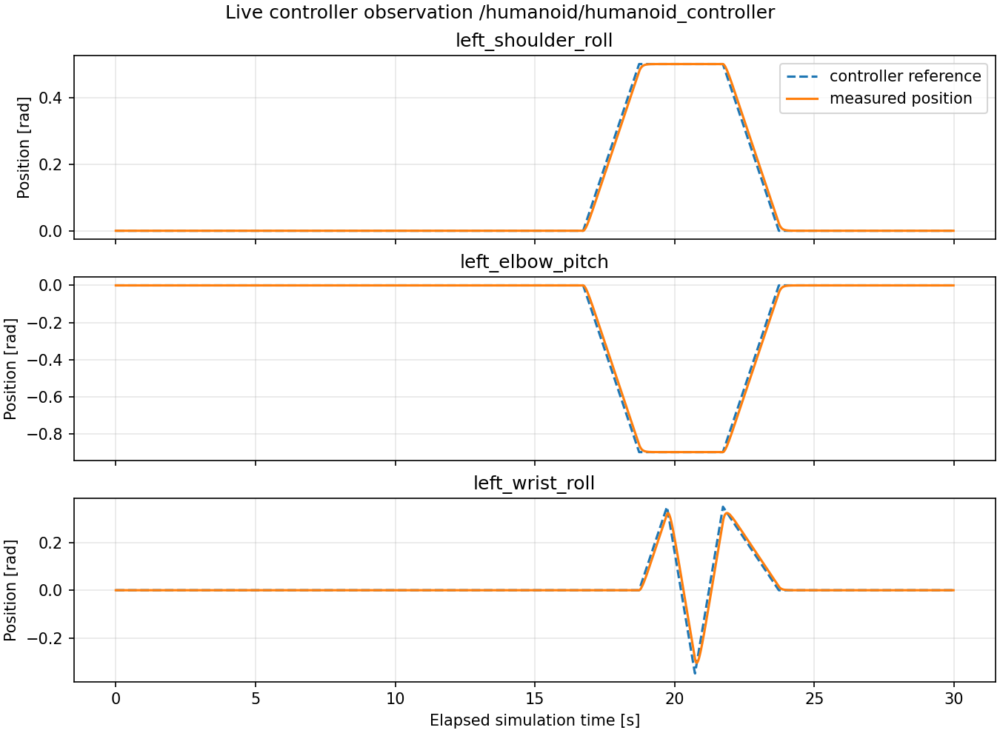
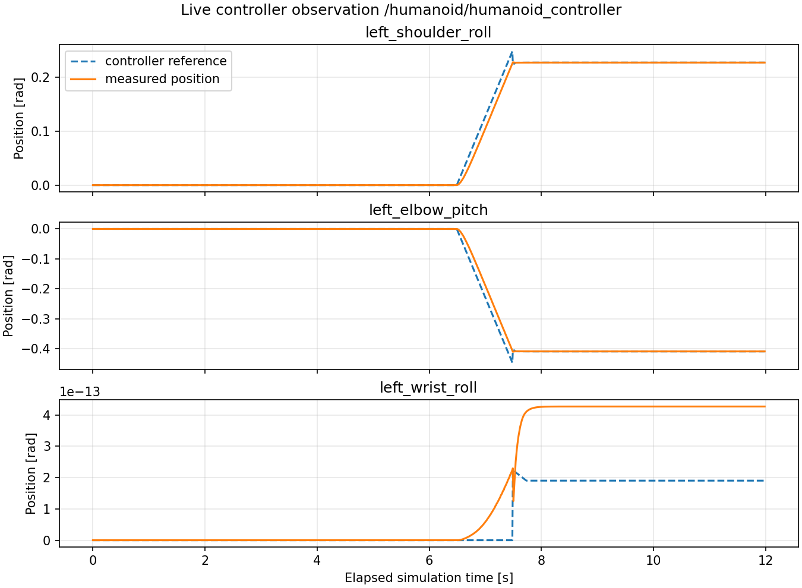

# ROS 2: управление 18 суставами через ros2_control

**2026 · ROS 2 Jazzy · ros2_control · JointTrajectoryController · Gazebo Harmonic · Python · Docker**

Настроено управление моделью гуманоидного робота с закреплённым тазом:
18 суставов, из них 8 в руках и 10 в ногах. Реализованы проверка траекторий,
расчёт ошибки по feedback и формирование цели удержания из измеренной позы.
В Gazebo выполнен сценарий **neutral → wave → neutral**, проверены отмена,
удержание промежуточной позы и запуск в другом namespace.

## Что сделано

- Настроены `joint_state_broadcaster` и `humanoid_controller` типа
  `JointTrajectoryController`: полный список из 18 суставов, команда
  `position`, состояния `position` / `velocity`, `use_sim_time` и ограничения.
  Частота controller manager — 100 Гц.
- Реализована `build_points`: проверяет полноту и уникальность суставов,
  конечность чисел, пределы углов и строго возрастающие положительные
  `time_from_start`. Позиции формируются в порядке переданного `joint_names`.
- Реализована `tracking_error`: максимальное абсолютное расхождение
  `desired` и `actual` по суставам одного feedback-сообщения.
- Реализована `hold_point`: создаёт цель из измеренного положения суставов,
  проверяет ограничения и сохраняет требуемый порядок суставов.
- Проверена работа клиента `FollowJointTrajectory`: приём и результат цели,
  feedback, отмена и отправка новой цели удержания по свежему снимку измерений.
- Добавлены собственные тесты на ненулевую measured hold pose, перестановку
  суставов, граничные значения, некорректные числа и неизменность входных данных.

Основные изменения: [controllers.yaml](homework/controllers.yaml),
[trajectory.py](homework/trajectory.py),
[собственные тесты](tests/test_my_trajectory.py).
Модель, launch и action transport предоставлены учебным стендом; реализованы
конфигурация контроллера, три прикладные функции и регрессионные проверки.

## Результаты в Gazebo

| Сценарий | Результат | Отчёт |
| --- | --- | --- |
| Neutral → wave → neutral | `SUCCEEDED`, `error_code=0`, 302 feedback-сообщения; все наблюдаемые суставы в пределах модели | [Миссия](reports/mission.json) |
| Максимальная наблюдаемая ошибка слежения | **0,06369 рад** при допуске 0,30 рад | [Измерения по суставам](reports/mission.json) |
| Ошибка по снимку клиента сразу после завершения | **0,03989 рад** при конечном допуске 0,12 рад | [Событие `succeeded`](reports/mission.json) |
| Отмена через 2 с симуляции | Зафиксированы `canceled`, принятие hold и измеренное удержание; отклонение от снимка **2,60 × 10⁻⁷ рад** | [Отмена](reports/cancel.json) |
| Другой namespace, обратный порядок суставов, масштаб времени 1,2 | `/group5/demo`, `SUCCEEDED`, длительность движения 9,6 с вместо 8 с; конечная ошибка 0,03733 рад | [Вариант](reports/variant.json) |
| Прерывание клиента через Ctrl+C | Выполнены отмена и measured hold, отклонение **1,36 × 10⁻⁷ рад**; `passed=false` отмечает намеренное прерывание | [Прерывание](reports/interrupt.json) |

**0,040 рад — ошибка в момент завершения действия. Максимальная ошибка
слежения за время записи — около 0,064 рад.** Эти метрики относятся к разным
моментам и не заменяют друг друга.

На графике миссии показаны reference контроллера и измеренные положения
плеча, локтя и запястья. Время отсчитывается от начала записи:



При отмене удерживается ненулевая промежуточная поза: локоть примерно
−0,408 рад, плечо примерно 0,227 рад. Запястье в этом опыте почти неподвижно;
его график имеет масштаб 10⁻¹³ рад.



Числа и графики взяты из сохранённых экспериментов. В `reports/` находятся
события клиента и сводки независимого наблюдателя без больших массивов
feedback и исходных измерений. Поле `_excerpt` сохраняет имена и SHA-256
полных файлов из локального `evidence/`. Подробности среды и проверок:
[diagnosis.yaml](diagnosis.yaml).

## Как воспроизвести

Нужны Docker и Compose v2. Команды выполняются в Bash на Linux или Ubuntu/WSL.
ROS 2 и Gazebo работают в контейнере.

### Подготовка и сборка

Из корня репозитория:

```bash
cd humanoid_control
id -u
id -g
```

Если UID/GID отличаются от 1000, добавьте в локальную `.env` свои значения
`LOCAL_UID` и `LOCAL_GID`. Затем в терминале хоста:

```bash
docker compose up -d --build --wait workspace
docker compose exec workspace bash
```

В контейнере:

```bash
source /opt/ros/jazzy/setup.bash
colcon build --symlink-install --event-handlers console_direct+
source /workspace/install/setup.bash
python3 -m pytest -q tests
```

В каждом дополнительном терминале хоста открывайте `docker compose exec
workspace bash`, а внутри контейнера выполняйте оба подключения окружения:

```bash
source /opt/ros/jazzy/setup.bash
source /workspace/install/setup.bash
```

### Сцена и контроллеры

В первом терминале контейнера оставьте работающим launch:

```bash
ros2 launch control_lab sim.launch.py \
  mode:=homework \
  controller_config:=/workspace/homework/controllers.yaml \
  namespace:=humanoid gui:=false rviz:=false
```

Во втором терминале контейнера:

```bash
ros2 control list_controllers -c /humanoid/controller_manager
ros2 control list_hardware_interfaces -c /humanoid/controller_manager
```

Ожидаются активные `joint_state_broadcaster` и `humanoid_controller`,
а также position command interfaces для всех 18 суставов.

### Движение и независимая запись

В третьем терминале контейнера начните запись до отправки цели:

```bash
ros2 run control_lab lab measure --duration 30 --timeout 180 \
  --output /workspace/evidence/mission-measured.json
```

Сразу после начала записи во втором терминале:

```bash
python3 /workspace/homework/client.py --timeout 180 \
  --output /workspace/evidence/mission-client.json
```

После завершения записи:

```bash
ros2 run control_lab lab report --input /workspace/evidence/mission-measured.json
ros2 run control_lab lab plot --input /workspace/evidence/mission-measured.json \
  --output /workspace/evidence/mission-measured.png \
  --joints left_shoulder_roll left_elbow_pitch left_wrist_roll
```

### Отмена и measured hold

В третьем терминале начните новую запись:

```bash
ros2 run control_lab lab measure --duration 12 --timeout 180 \
  --output /workspace/evidence/cancel-measured.json
```

Во втором терминале запустите отмену через 2 секунды симуляции:

```bash
python3 /workspace/homework/client.py --cancel-after 2 --timeout 180 \
  --output /workspace/evidence/cancel-client.json
```

Клиент фиксирует отмену, принимает новую цель hold и измеряет отклонение
от снимка суставов. `duration` и `cancel-after` используют sim time;
`timeout` ограничивает ожидание по wall time. Для медленной симуляции
timeout можно увеличить до 300 с.

Проверка другого namespace, порядка суставов и масштаба времени описана в
[сценариях стенда](docs/Homework_L05.md). Перед сменой namespace остановите
предыдущий launch. Для графики запустите сцену с `gui:=true rviz:=true` и
откройте [рабочий стол](http://localhost:6085/vnc.html?autoconnect=true&resize=scale).

### Завершение

Дождитесь результата движения или отмены и удержания, затем окончания записи.
Остановите launch через Ctrl+C. В терминале хоста из `humanoid_control/`:

```bash
docker compose down --timeout 10
```

## Структура и границы проекта

| Путь | Назначение |
| --- | --- |
| `homework/controllers.yaml` | Конфигурация ros2_control и допуски |
| `homework/trajectory.py` | Валидация траекторий, tracking error, measured hold |
| `homework/mission.json` | Целевые позы neutral → wave → neutral |
| `homework/client.py` | Action transport, feedback и отмена |
| `src/control_lab` | Модель, launch, запись и визуализация измерений |
| `tests/` | Контрактные и собственные регрессионные тесты |
| `reports/`, `docs/images/` | Сводки экспериментов и графики |

Проект основан на прежнем `task05` курса SHAD ROS 2. Таз модели закреплён;
баланс и ходьба не входят в сценарий. Контракты интерфейсов и измерений
сохранены в [docs/CONTRACT.md](docs/CONTRACT.md).
